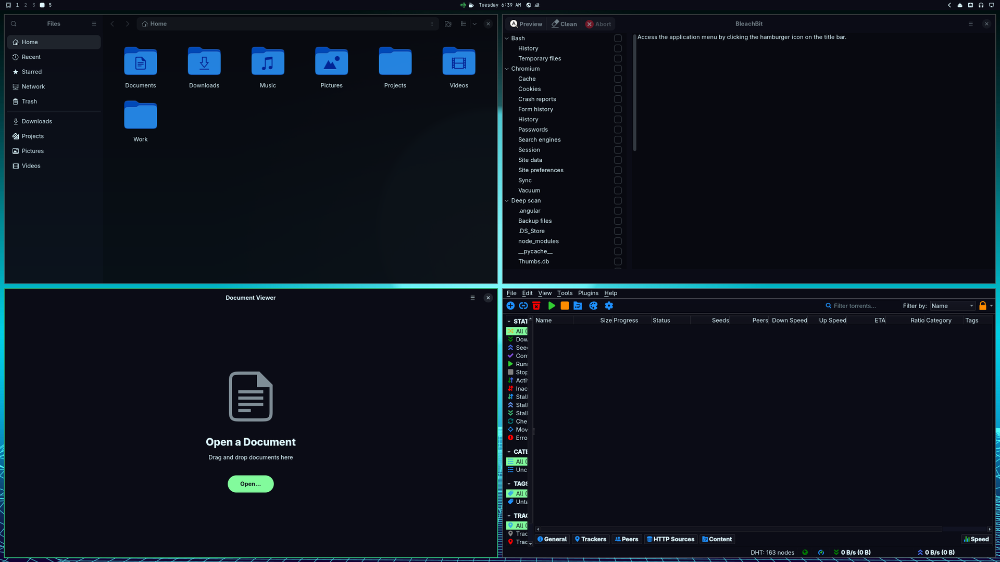

# Chroma

**Omarchy themes your terminal, editor, and shell. Chroma is the big
one-sweep: it paints the GTK and Qt *pipelines* most desktop apps already
use, so dozens of programs pick up the active theme without an Appearance picker
or a per-app skin.**



Stock Omarchy flips Nautilus, BleachBit, Evince and friends between light and
dark Adwaita. That is all they ever get: the same default gray in every theme.
Your desktop wears Hackerman neon; your file manager wears beige.

Chroma closes that gap. Enable it once and every `omarchy theme set` paints
GTK3, GTK4 / libadwaita, and Qt (via Omarchy's stock `QT_QPA_PLATFORMTHEME=gtk3`)
with the active theme's real colors — background, foreground, accent,
destructive / success / warning — light and dark alike.

GTK3 and Qt repaint **live**: Chroma writes a generated theme next to
`adw-gtk3` and rotates between two copies on each palette change, so open
windows follow without a relaunch. Two things still need a relaunch: GTK4 /
libadwaita, which reads user CSS once per process, and libhandy-based GTK3
apps such as GNOME Disks after a switch to a dark theme (see
[Limits](#limits-honestly)).

No Appearance carousel. You are not picking between “GTK” and “Qt” like they were
themes — you are feeding color data into the two toolkits almost every
non-Electron Linux GUI shares. One hook, every `colors.toml` Omarchy knows
about (stock, user forks, third-party installs). That is the whole point.

## Why this exists (and where it stops)

I spent time on **Archinstall + Hyprland + [Noctalia](https://github.com/noctalia-dev/noctalia-shell) 4.x + Catppuccin** across a whole system. Their theming engine was (and probably still is) excellent — credit where it is due. Sitting in that setup while Omarchy 3.x still felt thin on theming, I got the itch to theme *everything*. Most of that Noctalia-era work was manual and locked to one palette anyway. When Hypr Lua configs got messy and I did not want to babysit them, I came back to Omarchy with a bit of restraint: extend what actually accepts color data, leave the rest alone.

What actually tipped me into building these extenders was a theme that already looked *good* on stock Omarchy ([Asphalt Legends](https://github.com/AlxWolfenstein97/omarchy-asphalt-legends-theme) and friends). Fair that Omarchy only goes so far in the core (4.x does more of the shell now, yes) — once a palette sits cleanly there, it’s natural to ask how far the same `colors.toml` can ride without becoming a cat-and-mouse fight. So: care, a stop-line, and something that works across **every** installed theme instead of a one-theme manual stack. That last part is deliberate incentive — for me and for anyone else writing themes — to make more of them, because the desktop can follow further without each repo shipping its own private theming engine.

Omarchy 4 baked agents, skills, and docs into the distro. DHH’s tagline moved toward *Beautiful, Fun & Agentic Linux* — and with that tooling in place, those Noctalia-era ideas got Omarchy-fied: itemised plugins that read the same 3.x `colors.toml` format, convert where needed, and work across every theme by design. Formats can grow later; the contract is “give us color data (or something we can convert).”

The [plugin marketplace](https://plugins.omarchy.org/) feels a bit like a game workshop, except you’re not modding a game — you’re modding the system. A few of those “just a few things,” until they add up. I assumed someone else would fill gaps like this first; contributing anyway has been fun, and it was a concrete way to learn what “plugins run unsandboxed code” actually means (bootloader colors will teach you that “you can touch everything” real quick). Thousands of plugins in a month makes more sense when AI meets a shell that powerful. Handy homework if I ever roll my own Arch (or car) experiment again.

These plugins push [DHH](https://dhh.dk/) / Omarchy’s color-coordinated desktop as far as it can **reasonably** go. Limitations are documented on purpose. If upstream never wants them as official defaults because of those trade-offs, that is fine — they stay optional. I change themes roughly every three weeks to every three months; for that cadence the restart quirks are cheap. Themes keep working without any of this. Authors can stick to the snappier stock pipeline. End users pick the extenders they want. The inch-a-lada is optional; making the system feel like *yours* is the point.

Sibling Appearance plugins ([OmaOBS](https://github.com/AlxWolfenstein97/omaobs), [OmaCursor](https://github.com/AlxWolfenstein97/omacursor), [OmaBoot](https://github.com/AlxWolfenstein97/omaboot), [OmaVT](https://github.com/AlxWolfenstein97/omavt), [OmaTTY](https://github.com/AlxWolfenstein97/omatty), [OmaHud](https://github.com/AlxWolfenstein97/omahud)) target one surface each and ship an Appearance carousel so you can preview the same palette (or font / HUD tint) across every installed theme faster than flipping by hand. Those pickers draw PNG mockups with **Pillow** (`python-pillow`) — their installers pull that package *before* warming tiles. Chroma is different: it is the broad toolkit sweep, so silent `theme-set` sync is the right UX — **no carousel to warm**, and **no Pillow**. [OmaMenu](https://github.com/AlxWolfenstein97/omamenu) is the same story (shell/Quickshell only). None of these plugins require each other; together they cover a lot.

Theme authors are free to mention these as extenders in their repos — or not. Grab whatever theme you like; the plugins still apply.

### Why GTK & Qt (pipelines, not apps)

Most “apps” on a Linux desktop are not custom paint engines. They speak **GTK** or **Qt**. Recolor those pipelines and you recolor Nautilus, Evince, BleachBit, File Roller, qBittorrent, qpwgraph, and a long tail of friends in one shot — without asking each upstream for a theme file.

That is the opposite of shipping a skin for OBS (where a real theme format exists — see OmaOBS) or patching Chromium / Steam / a website. Those either have no stable color contract, own their own UI chrome, or update on someone else’s schedule. Fighting that is a cat-and-mouse game with people who never asked for your patches; asking strangers to install your fork of Chromium or Steam is weirder still. Websites are worse: content CSS is not your desktop.

**Hard stop:** if something cannot wear *any* installed Omarchy theme from `colors.toml` alone after a full restart — without binary forks, per-site CSS farms, or chasing remote content — Chroma (and this family of plugins) will not pretend it can. Leftovers that feel half-assed if forced: the open web, Steam Library / friends / settings, WhatsApp / Voice web UIs, LibreOffice document paper, mpv OSC, Goverlay chrome, one-off custom button skins. Unthemed beats fake.

Inspired by [Accord](https://github.com/vonsensey/accord), which proved the GTK `@define-color` bridge on Omarchy. Chroma keeps that core idea, hooks it straight into `theme-set.d` for an instant apply, prefers `adw-gtk3` when installed so GTK3 actually consumes the palette, and optionally themes root GUIs (`sudo` / `pkexec` BleachBit) with a one-time symlink — without forcing `qt6ct` or fighting Omarchy's Qt defaults.

## What you get

- **GTK4 / libadwaita** — Nautilus, Evince, Calendar, Text Editor, Loupe, …
  via `~/.config/gtk-4.0/gtk.css` (the only user lever libadwaita honors).
  Restart-only.
- **GTK3 — live** — a generated theme under
  `~/.local/share/themes/<base>-chroma-{a,b}` copies `adw-gtk3` (or stock
  Adwaita when the package is missing) and appends Chroma's palette. Switching
  themes alternates names so GTK3 re-reads its CSS and repaints open windows.
  libhandy apps (GNOME Disks) follow light switches but pin on any switch to
  dark; see [Limits](#limits-honestly).
- **Qt 5 / Qt 6 — live** — stays on Omarchy's `QT_QPA_PLATFORMTHEME=gtk3`, so
  Qt inherits the GTK3 palette Chroma just wrote. Qt's gtk3 platform theme
  re-reads the palette when the theme name changes. No qt6ct, no Kvantum, no
  shell-side icon side effects.
- **Chromium-family chrome — already Omarchy's job** — `omarchy-theme-set-browser`
  writes the theme's `chromium.theme` background into
  `BrowserThemeColor` + `BrowserColorScheme: device` under
  `/etc/chromium/policies/managed/color.json` (also Chrome, Edge, Brave), then
  refreshes running browsers. Chroma does not duplicate or override that.
  Firefox / Zen have no equivalent color policy: expect GTK-native controls
  and light/dark `prefers-color-scheme`, not the full accent palette.
- **Electron** — Electron is Chromium/Node, not a separate toolkit. Chroma
  supplies what Electron does consume: GTK native widgets/dialogs, and portal
  `prefers-color-scheme` for `nativeTheme`/`matchMedia` live. Verified with an
  Electron 43 probe: `nativeTheme.shouldUseDarkColors` flips live in both
  directions when Chroma changes `color-scheme`, with no restart. Omarchy
  already syncs Obsidian and VS Code theme files on its own; Chroma adds the
  GTK/portal layer, not another app theme. Apps that paint their own chrome,
  or hardcode a theme on first run, stay their own. (There is no “Qt Electron”;
  the Qt bridge only covers real Qt apps.)
- **Root apps (optional)** — one-time `/root/.config/gtk-*` and
  `/root/.local/share/themes` → your dirs, so `sudo bleachbit` / pkexec GUIs
  launch with the active palette. A root window does not share your session
  settings bus, so it does **not** repaint live on a switch — relaunch it.
  Password once; later launches follow the current theme. On Wayland a root GUI
  may need XWayland access (`xhost +SI:localuser:root`, revoke after); that is
  a desktop-session concern, not something Chroma changes.
- **Light and dark** — `color-scheme` and `gtk-theme` stay mode-correct,
  preferring adw-gtk3 over stock Adwaita when available.

| Surface | On `omarchy theme set` | What makes it move |
|---------|------------------------|--------------------|
| GTK3 apps (user, non-libhandy) | **live** | wrapper theme name flips a → b |
| GTK3 + libhandy (GNOME Disks) | light: live; dark: restart | libhandy pins the theme to Adwaita when Omarchy writes `Adwaita-dark` |
| Qt 5 / Qt 6 apps (user) | **live** | gtk3 platform theme re-reads named colors |
| Electron `nativeTheme` / `matchMedia` | **live** | portal `org.freedesktop.appearance color-scheme` |
| GTK4 / libadwaita apps | restart | `~/.config/gtk-4.0/gtk.css` is read once per process |
| Chromium-family browser chrome | Omarchy refresh | `BrowserThemeColor` policy; not Chroma |
| Root GUI (`sudo` / pkexec) | restart | root links carry the palette; no shared settings bus |

## Marketplace consent (theme-set hook)

Installing the plugin only drops the code. The theme-set hook edits your
Omarchy config, so it stays **opt-in**.

**Fast path (no prompts)** — from your home folder:

```sh
~/.config/omarchy/plugins/io.github.alxwolfenstein97.chroma/install.sh --yes
```

`--yes` means: I consent — arm everything this plugin supports, skip Y/n. Interactive `./install.sh` (no `--yes`) still asks — Workshop-safe; `--yes` / arm-all are optional shortcuts.
Theme-set helper: `./tools/install-theme-hook.sh --yes`.

**Arm the whole family in one shot** (arms only what’s already installed — omit any `plugin add` you don’t want):

```sh
~/.config/omarchy/plugins/io.github.alxwolfenstein97.chroma/tools/arm-all-family.sh
```

**Full wipe (this plugin)** — same ease as `install.sh --yes`
(full teardown + `plugin remove`; ledger-only `pkg drop` — only packages this install
recorded pulling; pre-existing deps stay; drop may fail and the package stays if something
else still needs it — e.g. you installed Goverlay after we pulled Pillow — that’s fine):

```sh
~/.config/omarchy/plugins/io.github.alxwolfenstein97.chroma/uninstall.sh --yes
```

**Wipe the whole family** (runs each plugin’s `uninstall.sh --yes` — same full
teardown as a single-plugin wipe; ledger-only pkg drops, no blanket shared-dep sweep —
drop may fail and stay if something else still requires the package):

```sh
~/.config/omarchy/plugins/io.github.alxwolfenstein97.chroma/tools/wipe-all-family.sh
# optional OCD: add --purge-tombstones (see Tombstones below)
```

### Tombstones (after wipe)

Harmless sticky note at `~/.local/state/omarchy/<plugin>/uninstalled`. The next
install (quiet or loud) uses it to clear same-session `/run` package-prompt
stamps / shared Pillow claims, then deletes the note. Logout/reboot clears those
stamps anyway. Theme-set sync stays off after wipe because armed state is gone — not
because of the stone. Normal boom-out → loud boom-in (arm-all) does **not** need
`--purge-tombstones`.

Optional OCD wipe of the notes themselves:

```sh
~/.config/omarchy/plugins/io.github.alxwolfenstein97.chroma/tools/wipe-all-family.sh --purge-tombstones
```

Interactive `./install.sh` still asks [Y/n] if you prefer. Quiet shell restarts
only restore what you already armed. `./uninstall.sh --yes` is a full wipe for
that plugin (same teardown family wipe runs); without `--yes` you get TTY
prompts for optional package drops.

## Install

Workshop-style one paste (enable + integrate; installer asks [Y/n]):

```bash
omarchy plugin add https://github.com/AlxWolfenstein97/chroma.git --enable
~/.config/omarchy/plugins/io.github.alxwolfenstein97.chroma/install.sh
```

That clones into `~/.config/omarchy/plugins/io.github.alxwolfenstein97.chroma` and arms the theme-set hook after you
confirm. Skip prompts: `~/.config/omarchy/plugins/io.github.alxwolfenstein97.chroma/install.sh --yes --with-root`.

Or from an existing checkout:

```bash
~/.config/omarchy/plugins/io.github.alxwolfenstein97.chroma/install.sh
omarchy plugin enable io.github.alxwolfenstein97.chroma
```

**Packages the installer pulls when missing:**

| Package | Why |
|---------|-----|
| `adw-gtk-theme` | Chroma copies `adw-gtk3` / `adw-gtk3-dark` into a generated wrapper theme. Without it the wrapper falls back to stock Adwaita, whose GTK3 CSS uses literal colors — Qt still recolors via `lookup_color`, but classic GTK3 chrome stays beige. |

`omarchy pkg add` needs sudo. Interactive `install.sh` asks in that TTY.
Shell-service `--quiet` never re-pulls `adw-gtk-theme` — that path only
restores already-armed wiring after login. Deps come from interactive
`install.sh`, `install.sh --yes`, or family `arm-all-family.sh`.
If the package is missing after a wipe: `omarchy pkg add adw-gtk-theme` then
`omarchy theme refresh` (or re-run `install.sh` without `--quiet`).

Nothing else. No Pillow — Chroma has no Appearance carousel. The Extender siblings
(OmaCursor / OmaOBS / OmaBoot / OmaVT / OmaTTY / OmaHud) pull `python-pillow` for their
mockups; that is a separate dep family.

## How it works

1. A script in `~/.config/omarchy/hooks/theme-set.d/chroma` runs at the end of
   every `omarchy theme set` / `theme refresh`.
2. `bin/chroma-apply` reads the active theme's `colors.toml`, writes a managed
   libadwaita block into `gtk-4.0`, generates a GTK3 wrapper theme under
   `~/.local/share/themes`, updates both `settings.ini` files, and sets GNOME
   `color-scheme` / `gtk-theme`. Omarchy's own `omarchy-theme-set-gnome` writes
   `Adwaita` / `Adwaita-dark` earlier in the same switch (before any
   `theme-set.d` hook); Chroma replaces that with the wrapper name.
3. On a palette change it writes the **inactive** wrapper suffix and then
   switches the theme name. GTK3 re-reads its stylesheet, and Qt's gtk3
   platform theme re-reads named colors — both repaint live. An unchanged
   palette reuses the active wrapper and writes nothing.
4. A small shell **service** runs `install.sh --quiet` once at shell start
   (restores the theme-set hook if already armed; skips package installs —
   deps are interactive / `arm-all` / `install.sh --yes`). It does **not**
   probe-and-reapply on a timer — the hook already covers switches, and a
   second path made boots/theme flips feel heavier than they needed to.
5. Windowless GTK daemons (`--gapplication-service`) are restarted when they
   have no open window, so open apps are never killed mid-use. In wrapper mode
   the GTK portal is *not* bounced — it live-updates, and killing it would
   close an open file chooser. The legacy `--no-gtk-wrapper` mode keeps the
   old portal restart.

Idempotent: unchanged themes write nothing (byte-compared before write).

## What it writes — and what it does not

**Writes**

- `~/.config/gtk-4.0/gtk.css` — marked `chroma:managed` block; pre-existing
  user CSS is backed up once and kept.
- `~/.local/share/themes/<base>-chroma-{a,b}/gtk-3.0/` — generated GTK3 theme
  built from `adw-gtk3*` (or Adwaita) with the Chroma block appended. The next
  palette change rewrites the inactive copy, so two directories alternate.
- `~/.config/gtk-{3,4}.0/settings.ini` — theme name, prefer-dark, font
  (no icon / cursor keys — Omarchy owns those).
- Two gsettings keys: `color-scheme`, `gtk-theme` (originals saved for revert).
- `~/.local/state/omarchy/chroma/state.json` — last apply metadata.

**Optional ( `--with-root` )**

- Symlinks `/root/.config/{gtk-3.0,gtk-4.0,qt6ct,qt5ct}` and
  `/root/.local/share/themes` → your matching dirs.
- On a TTY (arm-all / interactive / wipe), elevation uses `sudo` so the
  password lands in the same terminal; `pkexec` is only the non-TTY fallback.
- Apply runs **before** the root link so user GTK dirs exist before
  `/root/.config` points at them.
- Users who linked before wrapper themes existed need one re-run:
  `./install.sh --with-root` (it notices the missing themes link).

**Escape hatch**

- `--no-gtk-wrapper` (one run) or `CHROMA_NO_GTK_WRAPPER=1` (persistent —
  export it before the theme-set hook runs) writes the old user CSS in
  `~/.config/gtk-3.0/gtk.css` instead. That path is restart-only for GTK3 and
  Qt; nothing else changes.

**Does not**

- Touch icon or cursor themes.
- Force `QT_QPA_PLATFORMTHEME` away from Omarchy's `gtk3`.
- Delete an unmarked `~/.config/environment.d/99-chroma-qt.conf` — apply and
  revert remove only files carrying the `Managed by Chroma` marker (or an
  empty Chroma-unique stub), matching the installer/uninstaller ownership rule.
- Network. Ever.
- Kill any app that owns a visible window.
- Theme the open web, Steam chrome, or any app that ignores platform colors.

## Fresh VM smoke test

```sh
omarchy plugin add https://github.com/AlxWolfenstein97/chroma.git --enable
# No Appearance carousel — theme-set hook sweeps GTK/Qt/icons on every Omarchy theme flip
# Pick a loud theme; confirm apps follow (adw-gtk via install.sh / arm-all if missing)
# plugin add alone + reboot → quiet restores wiring only; run install.sh / arm-all for deps/hooks
# ./uninstall.sh --yes → full teardown (same as family wipe for this plugin)
# Interactive ./uninstall.sh → TTY: root teardown + optional adw-gtk drop
```

## Disable vs remove

| Action | What happens |
|--------|----------------|
| `omarchy plugin disable …` | Shell service stops. **Theme hook still runs** — apps stay chromed on every theme switch. |
| `./uninstall.sh` then disable / remove | Hook gone, generated wrappers + CSS stripped, gsettings restored. Quiet Service only restores what was already armed — after wipe that’s nothing until a loud install. This TTY: root symlink / sudoers teardown (sudo) + optional y/N `pkg drop` of packages this install recorded pulling (`adw-gtk-theme` when ledgered). |
| `omarchy pkg drop adw-gtk-theme` | Optional — only if this install recorded pulling it; may fail/stay if something else still requires it. Back to stock Adwaita when dropped. |

**Full wipe** — one shot (`--yes` skips pkg Y/n, ledger-only drops of packages this install recorded pulling (may fail and stay if something else still needs them — e.g. Goverlay after Pillow), and removes the plugin):

```sh
~/.config/omarchy/plugins/io.github.alxwolfenstein97.chroma/uninstall.sh --yes
```

## Limits, honestly

Most GTK3 and Qt apps now follow a theme switch **live** — Chroma swaps the
active theme name instead of only rewriting user CSS. What still lags is
documented below; we never kill a window that is in use to force a repaint.

- **GTK4 / libadwaita** — reads `~/.config/gtk-4.0/gtk.css` once per process.
  Nautilus, Evince, Calendar, Text Editor, Loupe and friends need a restart
  after a switch. This is the one remaining restart-only toolkit.
- **GTK3 apps built on libhandy** — GNOME Disks and Document Viewer are the
  common ones. Light switches keep following live, but **any** switch to a dark
  theme pins the open window to stock Adwaita until you relaunch it. This even
  happens on dark → dark: `omarchy-theme-set-gnome` writes
  `gtk-theme=Adwaita-dark` before user `theme-set` hooks run; libhandy's
  `HdyStyleManager` sees the `-dark` name, strips it, installs `Adwaita` as an
  *application* setting, and GTK3 then ignores every later session theme change
  for that process. Light switches write plain `Adwaita`, which libhandy resets
  instead of pinning, so those recover live. This is a libhandy + GTK3 behavior
  triggered by Omarchy's ordering, not by wrapper rotation. Chroma names the
  affected windows in its output (`relaunch Disks (libhandy pinned to
  Adwaita)`) so the one stuck window is not a mystery. The legacy
  `--no-gtk-wrapper` mode does not avoid the pin, but it leaves Chroma's palette
  in `~/.config/gtk-3.0/gtk.css`, already loaded by the process, so the window
  keeps its previous palette instead of dropping to Adwaita — at the cost of
  losing live GTK3 and Qt updates for every app. That is why the wrapper stays
  the default: relaunching one libhandy window beats restarting everything.
- **GTK3** — live when `adw-gtk-theme` is installed. Without it the generated
  theme is built on stock Adwaita, whose CSS uses literal colors: Qt still
  recolors, but classic GTK3 chrome stays beige until you install
  `adw-gtk-theme` and re-apply.
- **Qt** — live with `QT_QPA_PLATFORMTHEME=gtk3` (Omarchy's default). If you
  force qt6ct/Kvantum yourself, Chroma no longer guarantees the bridge.
- **Root GUIs** (`sudo bleachbit`, pkexec) — themed from the shared root links,
  but restart-only in practice: a root process launched from your session still
  reads its own settings, so an already-open root window keeps the old palette.
  Relaunch it; Chroma will not kill it for you.
- **Chromium / Electron** — Chromium-family browser chrome is Omarchy's existing
  `chromium.theme` policy (background color only); Chroma adds the GTK frame and
  live portal `prefers-color-scheme`. Electron follows the same portal signal
  for `nativeTheme` / `matchMedia` and uses GTK for native dialogs, but its own
  web chrome may not. Obsidian's onboarding, for example, hardcodes its dark
  body. There is no Qt-based Electron toolkit to target.
- **Apps with their own skins** (OBS themes, Steam, some Electron) ignore
  platform GTK/Qt colors. Use a dedicated extender (OmaOBS, Omacord, …) or leave them — do not expect Chroma to invent a contract
  that is not there.
- **LibreOffice** themes chrome via GTK; some notebook/brand strips stay LO's
  own blue. Document background is a LO setting (“use printer metrics” /
  white-document prefs), not Chroma.
- **Momentary default theme during a switch** — `omarchy-theme-set-gnome` runs
  before any `theme-set.d` hook and writes `gtk-theme=Adwaita` (light) or
  `Adwaita-dark` (dark). GTK3 apps can paint that default for a moment until
  Chroma's hook writes the wrapper name. Chroma cannot move itself ahead of
  Omarchy's own theme commands, so the flash is the upstream ordering, not a
  stale wrapper. On light themes it is Adwaita-light and easy to miss; on dark
  themes it reads as the default gray.
- **Plain GTK4 apps** (not libadwaita) fall back to GTK's built-in
  Default-light/dark because wrapper themes only carry `gtk-3.0`. They are
  mode-correct, not accent-colored.
- **High-contrast themes** are not a wrapper base; the generated theme always
  starts from `adw-gtk3*` or Adwaita. If you need high contrast, use
  `--no-gtk-wrapper`.
- **Flatpak** needs the usual hole:
  `flatpak override --user --filesystem=xdg-config/gtk-4.0:ro <app>`.
- We recolor stock Adwaita / adw-gtk3 rather than shipping a full theme
  engine — keeps the bridge small and update-safe on Omarchy's stack.

If you are not the type who flips themes every afternoon: pick something you
like, reboot once, profit. Live sync is for people who enjoy the carousel.

## Check

```sh
bash ~/.config/omarchy/plugins/io.github.alxwolfenstein97.chroma/check.sh
```

## Credits

- [Noctalia](https://github.com/noctalia-dev/noctalia-shell) — the theming
  engine that first made “theme the whole machine” feel reachable; these
  Omarchy plugins grew out of that itch, then learned where to stop.
- [Accord](https://github.com/vonsensey/accord) by vonsensey — proved Omarchy
  themes can drive libadwaita via user CSS, and set the craft bar for
  merge-safe managed blocks, luma-distance on-accent text, and
  never-kill-a-window restarts.
- Sibling extenders: [OmaOBS](https://github.com/AlxWolfenstein97/omaobs),
  [OmaCursor](https://github.com/AlxWolfenstein97/omacursor),
  [OmaBoot](https://github.com/AlxWolfenstein97/omaboot),
  [OmaVT](https://github.com/AlxWolfenstein97/omavt),
  [OmaTTY](https://github.com/AlxWolfenstein97/omatty),
  [OmaHud](https://github.com/AlxWolfenstein97/omahud).
- Already solved elsewhere (gladly):
  - **[Omacord](https://github.com/ASwenia/omacord)** — Vesktop / Vencord Discord
    follows Omarchy themes live. No theme carousel / mockup picker: it **syncs**,
    and that’s the right call. Chat mockups are content-shaped anyway — you
    censor half the shot and still aren’t showing a true layout:  
    `omarchy plugin add https://github.com/ASwenia/omacord --enable`
- [OMCP](https://github.com/btsouth/omarchy-omcp) — MCP desktop bridge (themes,
  windows, screenshots, …). Helped build and iterate the preview here:
  `omarchy plugin add https://github.com/btsouth/omarchy-omcp --enable`
- [Omarchy](https://omarchy.org/) — theme pipeline, `theme-set` hooks, and
  the `gtk3` Qt platform theme this plugin deliberately stays aligned with.

## License

MIT — see [LICENSE](LICENSE).
